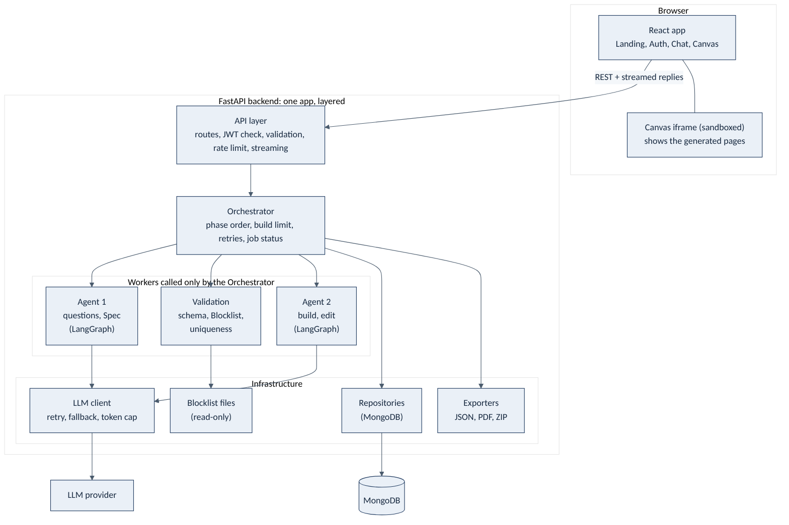
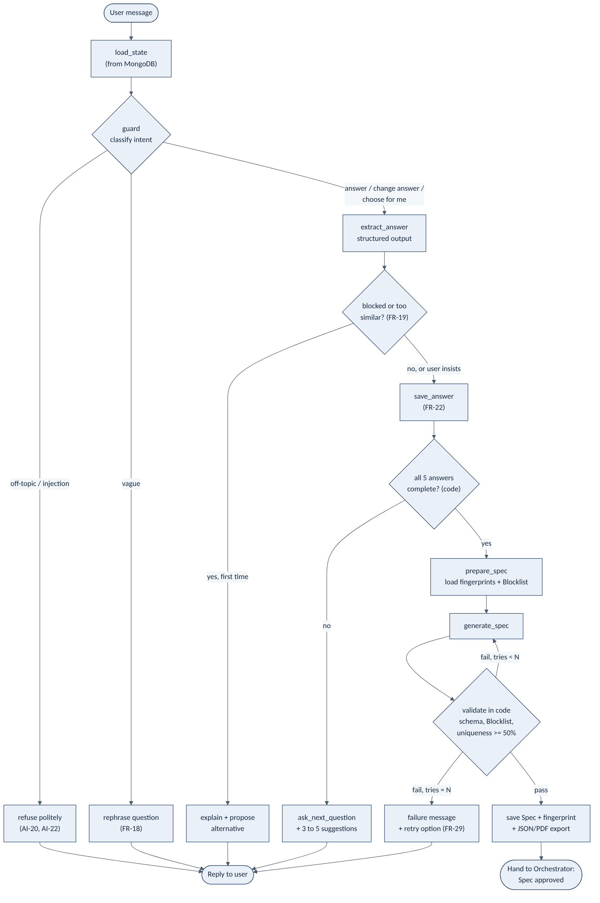
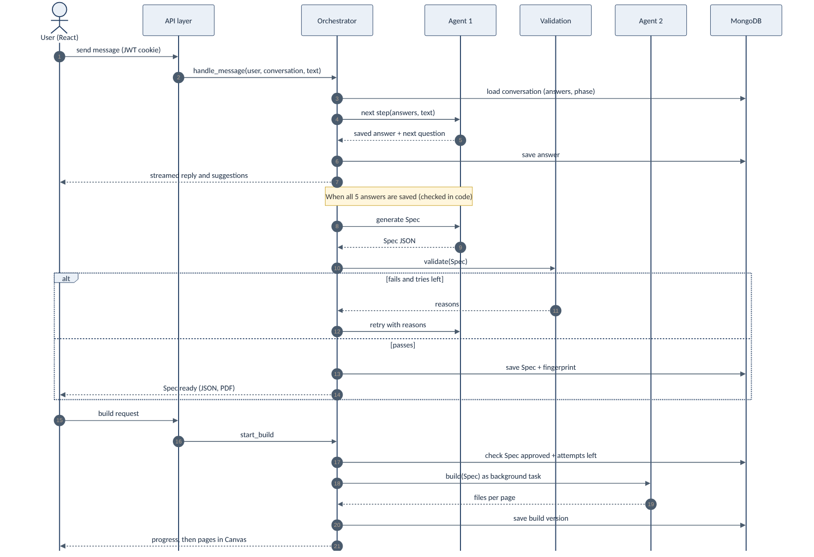
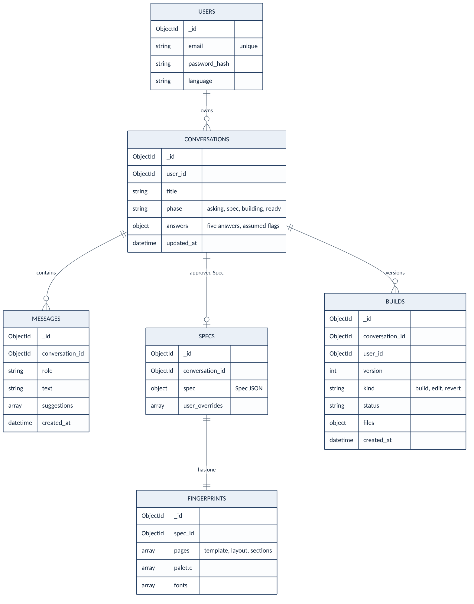

# YOUI: Architecture and Design Patterns

**Document:** `docs/architecture/ARCHITECTURE.md`  |  **Version:** 2.0 (simplified, for team review)  |  **Based on:** YOUI SRS  |  **Owner:** [name]

## 1. Summary

YOUI is built as **a layered modular monolith with an Orchestrator and two LangGraph agents**. It is one FastAPI application, one MongoDB database, and one React frontend. The design covers the whole SRS (Agent 1, Agent 2, Canvas, editing, versions, download) and avoids anything the project does not need: no microservices, no message broker, no event bus.

Requirement IDs (FR, NFR, AI) refer to the SRS.

**Build order**

| Milestone | Part of the architecture built |
| :---- | :---- |
| 1 (current) | API layer, auth (JWT), chat and history, Orchestrator, Agent 1, validation, fingerprints, Blocklist loader, repositories, LLM client, JSON and PDF export |
| 2 | Agent 2 build, Canvas (sandboxed preview) |
| 3 | Edits, versions, revert, ZIP download |
| 4 | Hardening, tests, evaluation |

## 2. Architecture at a glance



Each layer calls only the layer below it.

| Layer | Responsibility | SRS |
| :---- | :---- | :---- |
| React app | Landing page, sign-up and sign-in, chat with history, Canvas and edit chat | FR-01 to FR-12, FR-38 to FR-44 |
| API layer | Routes, JWT check, request validation, rate limiting, streamed replies, one error format | FR-05, NFR-05, NFR-11 |
| Orchestrator | The only component that decides what runs next: phase order, build-attempt limit, retries, background job status | FR-37, FR-48, FR-49 |
| Agent 1 | Asks the five questions, extracts answers, writes the Spec | FR-13 to FR-32 |
| Validation | Schema check, Blocklist check, uniqueness check, each returning reasons | FR-26 to FR-28 |
| Agent 2 | Builds React pages from an approved Spec and applies edits | FR-33 to FR-43 |
| Infrastructure | MongoDB repositories, LLM client, exporters, Blocklist file loader | NFR-12, NFR-13 |

**Why this design fits the SRS**

| SRS need | How the design handles it |
| :---- | :---- |
| Fixed phase order; agents never call each other (FR-48, FR-49) | The Orchestrator is plain code and is the only caller of the agents |
| The Spec is the only contract | One Pydantic `Spec` model, used by both agents and the validators |
| Validation in code, not by the LLM (FR-27) | A list of check functions run after every Spec generation |
| Build limit: 3 attempts, then wait T (FR-37) | A small function in the Orchestrator reading the `builds` collection |
| Long builds | A background task with a status field in `builds`; progress is streamed to the user |
| Edits, versions, revert (FR-41 to FR-43) | Every build or edit is a new `builds` document; a revert copies an old version as a new one |
| Generated code is untrusted (NFR-09) | The Canvas runs in a sandboxed iframe with no access to platform tokens |
| Switch models, survive rate limits (NFR-12) | One LLM client with retry and a fallback model |

## 3. Design patterns

### 3.1 Patterns to use

| Pattern | Use it for | Where in the code | When |
| :---- | :---- | :---- | :---- |
| Orchestrator (service layer) | Phase order, attempt limit, calling agents and validators | `services/orchestrator.py` | M1 |
| State machine (LangGraph) | The Agent 1 question loop; the Agent 2 build and edit flow | `agents/agent1/`, `agents/agent2/` | M1, M2 |
| Repository | All MongoDB access, always filtered by `user_id` | `repositories/` | M1 |
| Adapter with retry and fallback (decorator) | One client for every model call, with token cap and logging | `llm/client.py` | M1 |
| Validation pipeline | Ordered checks: schema, Blocklist, uniqueness | `domain/validation.py` | M1 |
| Strategy (a dictionary of functions) | Export formats and similarity measures chosen by name | `exporters/`, `domain/similarity.py` | M1 |
| Dependency injection | Pass the LLM client and repositories into services; use fakes in tests | FastAPI `Depends` | M1 |
| Snapshot versioning (simple Memento) | Each build or edit is a new version document; revert copies one | `repositories/builds.py` | M3 |
| Background job with status | Long builds run in the background and report progress | `services/build_jobs.py` | M2 |

### 3.2 Patterns deliberately not used

| Not used | Reason |
| :---- | :---- |
| Microservices, message broker | Too much operations work for this team; modules are already separated |
| CQRS and event sourcing | No requirement needs them |
| An LLM that decides the next step | The order is fixed by the SRS and decided in code |
| Event bus, Builder, Factory, Circuit breaker, Template method | A plain function or a small helper does the job |
| Singleton | Replaced by dependency injection and one cached settings object |

### 3.3 Code sketch

**Validation pipeline (FR-26 to FR-28)**

```python
CHECKS = [check_schema, check_blocklist, check_uniqueness]

def validate(spec: Spec, ctx: ValidationContext) -> ValidationResult:
    reasons = []
    for check in CHECKS:
        reasons += check(spec, ctx)   # each check returns a list of reasons
    return ValidationResult(approved=not reasons, reasons=reasons)
```

## 4. Rules

These five rules are checked in code review.

1. **Code controls the flow.** Loop exit, retries, limits, and phase changes are plain code. The LLM only classifies, extracts, and writes.
2. **Agents never call each other.** They exchange only the Spec JSON, through the Orchestrator (FR-49).
3. **Every database query is filtered by `user_id`,** except the fingerprint comparison, which reads design traits only.
4. **Every model call goes through the LLM client** and returns output validated against a schema.
5. **User text and generated code are never trusted.** Specs are validated, user text is passed to the model as data, and the Canvas is sandboxed.

## 5. Key workflows

### 5.1 Agent 1: question dialog and Spec



| Node | Type | What it does |
| :---- | :---- | :---- |
| `load_state` | Code | Loads answers and phase from the conversation document |
| `guard` | LLM + rules | Classifies the message: answer, change answer, choose for me, vague, off-topic, or injection attempt |
| `extract_answer` | LLM (structured) | Turns text or a chosen suggestion into a value; converts custom values such as a color name into a color code |
| `conflict_check` | Code | Checks the choice against the Blocklist and existing fingerprints; explains and proposes an alternative once; keeps the user's choice if they insist |
| `save_answer` | Code | Saves the answer at once, so a refresh loses nothing |
| `decide` | Code | Checks whether all five answers are complete |
| `ask_next_question` | LLM | Writes the next question with 3 to 5 suggestions that fit earlier answers |
| `generate_spec` | LLM (structured) | Writes the Spec JSON |
| `validate` | Code | Runs the validation pipeline; on failure retries with the reasons, at most N times |
| `finalize` | Code | Saves the Spec, fingerprint, and JSON and PDF exports |

### 5.2 From chat to build



### 5.3 Agent 2: build and edit (milestones 2 and 3)

| Step | Type | What it does |
| :---- | :---- | :---- |
| Check input | Code | Accepts only an approved Spec; checks the attempt limit |
| Plan pages | LLM | Plans files and components for up to 3 pages |
| Generate pages | LLM | Writes each page from the fixed project template, following every Spec element |
| Review | Code | Static checks of the files against the Spec: color codes, fonts, section names, call to action. Add a headless-browser check later if time allows |
| Fix | LLM | Regenerates the parts that failed, once, before showing an error |
| Save version | Code | Saves the build as a new version of the conversation |
| Edit | LLM + code | Applies a plain-language change to the current files, keeps the rest, saves a new version, and updates the Spec if a core element changed |

## 6. Data



- **Six collections,** matching the SRS: `users`, `conversations`, `messages`, `specs`, `fingerprints`, `builds`.
- **State lives in the conversation document.** It holds the five answers, the "assumed" flags, and the phase. Agent 1 loads it each turn; the LangGraph checkpointer is not needed until a run must resume mid-way.
- **Messages are separate** because they grow without limit.
- **Fingerprints are separate** so the uniqueness check reads small documents only. Each holds per-page traits (template, layout, section order) plus palette and fonts.
- **Builds hold the generated files.** MongoDB documents are limited to 16 MB; use GridFS only if a build can exceed that.
- **Indexes:** `users.email` (unique); `conversations(user_id, updated_at)`; `messages(conversation_id, created_at)`; `builds(user_id, created_at)` for the attempt limit.
- **Logging (FR-50)** goes to structured log output, not a collection.

## 7. Security

| Concern | Control |
| :---- | :---- |
| Authentication | JWT stored in an httpOnly, Secure, SameSite cookie with an expiry; passwords hashed with Argon2 or bcrypt |
| Access to other users' data | Repositories require `user_id`; other users' conversations return 404 |
| Prompt injection | `guard` node; user text sent as data, never as instructions; structured output; no LLM tool with side effects |
| Generated code | iframe `sandbox` without `allow-same-origin`; no tokens or cookies inside; strict CSP |
| Fingerprints | Traits only, never content; never sent to the client; conflict messages say only "too similar to an existing design" |
| Secrets and abuse | Keys in environment variables, `.env` not committed; per-user rate limit; token cap and retry cap |
| Blocklist files | Versioned in the repository, mounted read-only, validated at startup; the app refuses to start if invalid (FR-46) |

## 8. Code structure

```
backend/app/
  api/            routes, auth dependency, error format
  services/       orchestrator.py, auth_service.py,
                  conversation_service.py, build_jobs.py
  agents/         agent1/ (graph.py, nodes.py, prompts/), agent2/ (later)
  domain/         spec.py, validation.py, fingerprint.py, similarity.py
  repositories/   users.py, conversations.py, specs.py, builds.py
  llm/            client.py (retry, fallback, token cap)
  exporters/      json_export.py, pdf_export.py, zip_export.py
  config/         settings.py, blocklist/ (YAML files)
backend/tests/    unit/, conversations/ (scripted chats)
frontend/src/     pages/, components/, api/, i18n/
docker-compose.yml, .env.example
docs/             srs/, architecture/, ux/
```

`api → services → agents, domain → repositories, llm`. Lower layers never import upper ones. Prompts live in separate files.

## 9. API (summary)

| Endpoint | Purpose |
| :---- | :---- |
| `POST /auth/register`, `/auth/login`, `/auth/logout` | Account and session (login sets the cookie, logout clears it) |
| `GET` and `POST /conversations` | List and start conversations |
| `GET /conversations/{id}` | One conversation: answers, Spec, builds |
| `POST /conversations/{id}/messages` | Send a message; the reply is streamed |
| `GET /conversations/{id}/spec?format=json\|pdf` | Download the approved Spec |
| `POST /conversations/{id}/builds` | Start a build (409 without an approved Spec; 429 with `retry_after` at the limit) |
| `GET /conversations/{id}/builds` | Build versions and status |
| `POST /conversations/{id}/edits` | Apply an edit; creates a new version |
| `POST /conversations/{id}/builds/{version}/revert` | Revert to an earlier version |
| `GET /conversations/{id}/download` | ZIP of the current build |
| `DELETE /users/me` | Delete the account and its data |

Streamed replies use a `POST` response read with `fetch`, sending events such as `status`, `token`, `suggestions`, `spec_ready`, `error`, and `done`. Errors use one format: `{ "error": { "code": "...", "message": "..." } }`.

## 10. Key decisions

Status: **Confirmed** means the team decided it; **Proposed** means recommended here and needs team agreement.

### ADR-1: Layered modular monolith with an Orchestrator
- **Decision:** One FastAPI application with the layers in section 2; a plain Python Orchestrator calls the agents and validators.
- **Reason:** Simple to run and test, enforces FR-48 and FR-49, and a module can be split out later if needed.
- **Status:** Proposed.

### ADR-2: Stack
- **Decision:** FastAPI, React with Tailwind, MongoDB, LangGraph, JWT. Use an async ODM (for example Beanie) or the PyMongo async driver directly; check in Week 1 which is current and maintained.
- **Status:** Confirmed; ODM choice open.

### ADR-3: State in the conversation document
- **Decision:** The conversation document is the source of truth for answers and phase. Add the LangGraph MongoDB checkpointer later only if a run must resume mid-way.
- **Reason:** The dialog is turn-based, so one document read per turn is enough and there is only one place to look.
- **Status:** Proposed.

### ADR-4: Fingerprint and uniqueness score
- **Problem:** The SRS defines the score but not the formula, and a Spec can have up to 3 pages while the example fingerprint has one.
- **Decision:** One fingerprint per Spec with per-page traits plus palette and fonts. The score is a weighted average of element similarities, with colors compared by perceptual distance (for example CIEDE2000). Weights and threshold are in configuration. Compare against the closest earlier fingerprint. Specs the user insisted on are flagged `user_override`. Seed some fingerprints for testing, because an empty database makes everything unique.
- **Status:** Proposed; needs team review (SRS Open Question 1).

### ADR-5: Canvas runtime
- **Problem:** The SRS requires an isolated preview but does not say how generated React code is compiled and shown. This is the largest technical risk.
- **Decision:** Run the code in the browser with an in-browser bundler (for example Sandpack) inside the sandboxed iframe. Fix the project template and allow-list the packages, so the same files make the ZIP. Do a one-day spike before milestone 2. If it fails, build on the server and serve the result as static files from a separate origin.
- **Status:** Open.

## 11. Decisions the team must make

Proposed defaults are in brackets.

1. Which languages are supported? [Arabic and English, with right-to-left layout]
2. What does "3 build attempts" mean: per user for all time, per day, or per conversation? Does the automatic retry in UC-04 count? [per user per day; the automatic retry does not count]
3. Do edits have a cap? [yes, a daily limit per user]
4. When an account is deleted, are its fingerprints deleted or kept anonymized? [kept anonymized, if acceptable]
5. Which export formats are required? [JSON, PDF, and ZIP from the SRS; add Markdown and Google Docs only if confirmed]
6. Values for N (retries) and T (waiting period). [N = 3, T = 24 hours]
